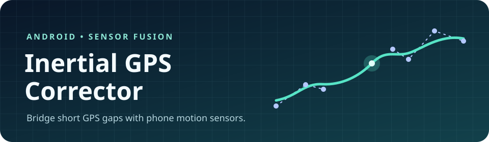
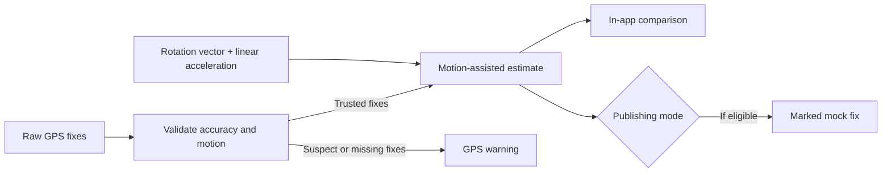

<p align="center">
  
</p>

<h1 align="center">Inertial GPS Corrector</h1>
<p align="center"><strong>See what your GPS reports and what your phone’s motion sensors estimate.</strong></p>
<p align="center">Android 8.0+ · Java · <a href="LICENSE">MIT License</a></p>
<p align="center"><a href="#quick-start">Quick start</a> · <a href="#publishing-modes">Publishing modes</a> · <a href="#how-it-works">How it works</a></p>

## Quick start

Download the signed APK from [GitHub Releases](https://github.com/pihta24/InertialGPSCorrector/releases/latest) and open it on your Android device to install. If you already installed the debug APK, Android will not update it in place because the signatures differ. Uninstalling the debug build removes its local data; select the release build again in Developer options if you use mock publishing.

To build from source, use **JDK 17+**, **Android SDK 36**, and `adb` on your `PATH`. Connect a phone with USB debugging enabled, or start an emulator.

```sh
./gradlew testDebugUnitTest lintDebug assembleDebug
adb install -r app/build/outputs/apk/debug/app-debug.apk
```

1. Enable device location, open the app, and tap **Start tracking**. Grant **Precise location** and allow notifications for background GPS warnings. Go outdoors for the first fix.
2. Compare **Raw GPS signal** with **Best available position**. The app shows the age and approximate accuracy of both. Tracking continues in a foreground service when you leave the screen.
3. Tap **Stop tracking** in the app or from its notification when you’re done.

## Start from a map pin

Before tapping **Start tracking**, tap **Select on map**, zoom to your current position, tap to place a pin, and choose **Use pin**. Start while stationary: the manual estimate starts with zero velocity, is labeled separately from GPS, and is replaced by the first trusted GPS fix. Choose **Use GPS** in the picker to clear the pin. The map requires internet access and loads tiles from OpenStreetMap; tracking itself does not require map access.

## Publishing modes

Publishing is optional and requires Google Play services and Android’s explicit mock-location authorization. Select **Inertial GPS Corrector** under **Developer options → Select mock location app**, then choose a mode under **Mock location output → Publish**. You can change the mode while tracking.

| Mode | What other apps receive |
| :--- | :--- |
| **Off** | No mock fixes. You can still compare estimates in the app. |
| **GPS outages only** | Motion-assisted fixes after more than 8 seconds without a trusted GPS fix (counted from tracking start if using a manual pin). Publishing stops when GPS recovers or the estimate expires. |
| **Anytime** | The latest usable estimate, including when GPS is working. Publishing pauses when no usable estimate is available. |

Only compatible apps using Google fused location receive these fixes. Android marks them as mock locations, and some apps reject them. Apps that read the raw GPS provider directly are not affected.

<details>
<summary>Can’t find the mock-location setting?</summary>

Use **Open Developer options** in the app. On the Russian-language RMX5011, look under **Местоположение → Выбрать приложение для фиктивных местоположений**. If your Android build doesn’t expose the picker, you can still preview estimates without publishing.

If tracking ends unexpectedly or the app reports it couldn’t clear mock mode, deselect it as your mock-location app before using other location apps.

</details>

## How it works



A trusted GPS fix or a manual map pin anchors the estimate. The app rotates gravity-free acceleration into Earth coordinates, integrates motion, and uses later GPS fixes and velocity to correct drift. It warns about poor accuracy, implausible jumps, and GPS silence. Without working motion sensors it can still show a fresh GPS fix.

> [!IMPORTANT]
> Motion-based estimates need an initial trusted GPS fix or a manually selected start point. There is no fixed outage or uncertainty cutoff: when sensors pause, the app holds the last estimate and resumes from the next usable sample. Accuracy is reported honestly as it grows. A wrong but plausible GPS fix can go undetected. Keep the phone steady or mounted, and test on a known route before relying on the estimate. **Not for safety-critical navigation.**

## License

The project’s original source and artwork are available under the [MIT License](LICENSE). Third-party components retain their own licenses.
